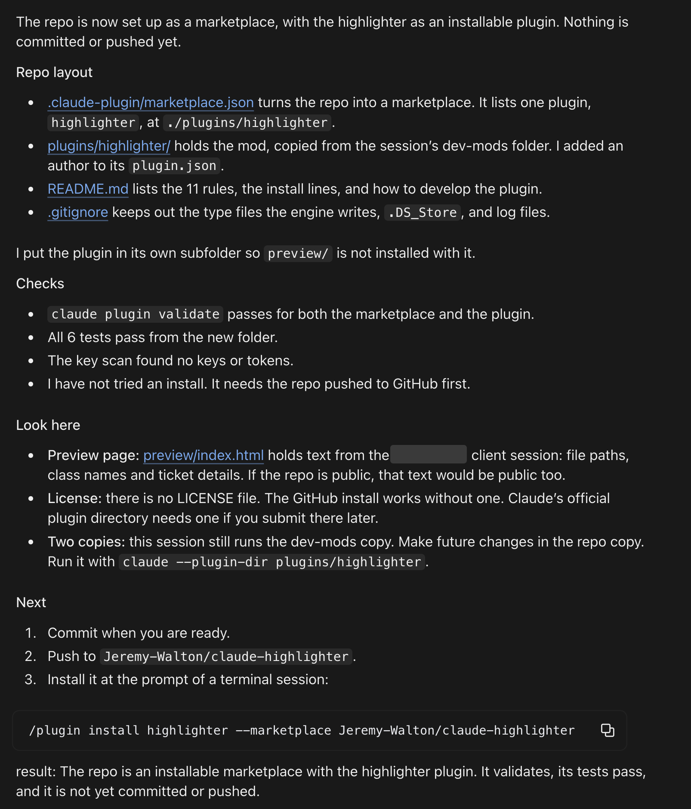
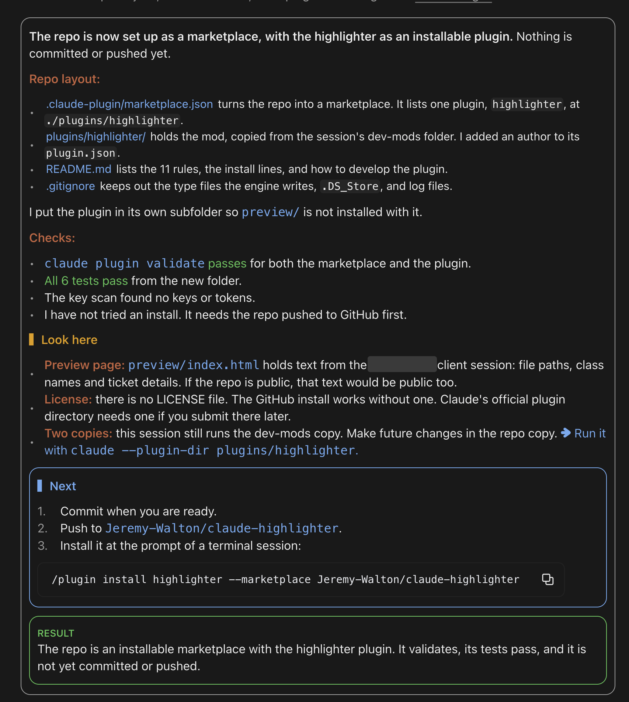

# Claude Highlighter

A Claude Code plugin that makes Claude's replies easier to scan. It redraws each reply with color, the way a syntax highlighter colors code. Claude's words and the saved transcript do not change.

It works in both the Claude Code terminal and the Claude desktop app. Each one draws the rules with its own theme colors.

## Before and after

| Before | After |
| --- | --- |
|  |  |

## Install

At the prompt of a Claude Code terminal session:

```
/plugin install highlighter --marketplace Jeremy-Walton/claude-highlighter
```

1. Answer `y` to add the marketplace.
2. Pick a scope. The user scope turns the highlighter on in every session.

From a shell:

```bash
claude plugin install highlighter --marketplace Jeremy-Walton/claude-highlighter
```

In the desktop app, where `/plugin` does not run:

1. Click **+** next to the prompt box, then **Plugins**.
2. Click **Add marketplace** and enter `Jeremy-Walton/claude-highlighter`.
3. Click **Add plugin** and pick **highlighter**.

The highlighter starts with the next reply. To turn it off, run `/plugin` and disable or uninstall **highlighter**.

## What it highlights

| # | Rule | What it does |
| --- | --- | --- |
| 1 | Section titles | Colors titles by type: green for Fixed or Summary, yellow for Look here or Risks, blue boxed for Next, purple for Decide |
| 2 | Lead-in labels | Colors labels such as `Routes:` or `**make-it-right** (1aede1b6b)` orange |
| 3 | Result box | Puts a `result:` line in a green RESULT box |
| 4 | Needs-you box | Puts a `needs input:` line in a red NEEDS YOU box |
| 5 | What you do | Colors sentences that ask you to act blue, with ➜ |
| 6 | Severity chips | Shows High, Medium and Low as colored chips |
| 7 | Pass and fail | Colors pass words green and fail words red |
| 8 | Counts and hashes | Bolds counts and colors commit hashes |
| 9 | Dim progress | Dims "still waiting" progress chatter |
| 10 | Headline | Bolds the first sentence of a report |
| 11 | Report card | Frames a reply that has titles or a result line |

Code blocks, tables and links keep Claude Code's own drawing, so links stay clickable.

## Themes

The default theme is **System**. On [Omarchy](https://omarchy.org/), System uses the colors of your current Omarchy theme and follows you when you switch themes. Anywhere else, System is the Terminal theme.

| Theme | Setting value |
| --- | --- |
| System (default): your Omarchy theme, or Terminal without Omarchy | `system` |
| Terminal: follows your Claude Code theme | `terminal` |
| Cobalt2 | `cobalt2` |
| Dracula | `dracula` |
| Nord | `nord` |
| Solarized Dark | `solarized-dark` |
| Gruvbox Dark | `gruvbox-dark` |
| Tokyo Night | `tokyo-night` |
| Lumon | `lumon` |
| GitHub Light | `github-light` |

To pick one, use any of these:

- Run `/highlighter-theme`. A picker opens with a preview of each theme. Press its number or click it.
- Run `/highlighter-theme dracula` to set a theme by name.
- Open `/config` and change **Color theme**.

The themes change only the highlighter's colors. Your terminal's background and text colors stay the same, so pick a theme that suits them.

### How System reads Omarchy

- It reads the current theme's `colors.toml` from `~/.local/state/omarchy/current/theme/`. Older Omarchy releases keep it in `~/.config/omarchy/current/theme/`, and a theme with no `colors.toml` is read from its `alacritty.toml`.
- It uses the theme's orange for labels, green for done, yellow for warnings, blue for next steps, magenta for decisions, red for failures, and cyan for code.
- It checks for a theme switch every 3 seconds, and open replies redraw in the new colors.

## Develop

The plugin lives in `plugins/highlighter/`.

- `hooks/blocks.ts` splits a reply into sections, lists, lead-ins and boxes.
- `hooks/inline.ts` splits text into sentences and marks the inline rules.
- `hooks/themes.ts` holds the fixed themes.
- `hooks/omarchy.ts` finds and reads the Omarchy theme.
- `hooks/register.tsx` draws the result, and adds the theme command and picker.

Run a session with your local copy:

```bash
claude --plugin-dir plugins/highlighter
```

Check and test it:

```bash
claude plugin validate plugins/highlighter
```

```bash
claude plugin test plugins/highlighter
```
